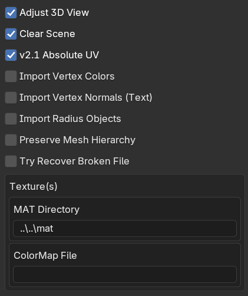
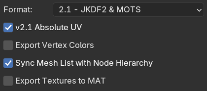
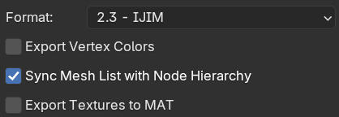
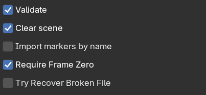
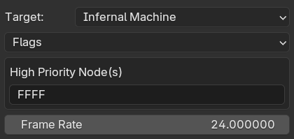
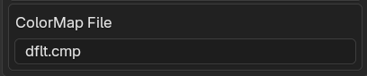
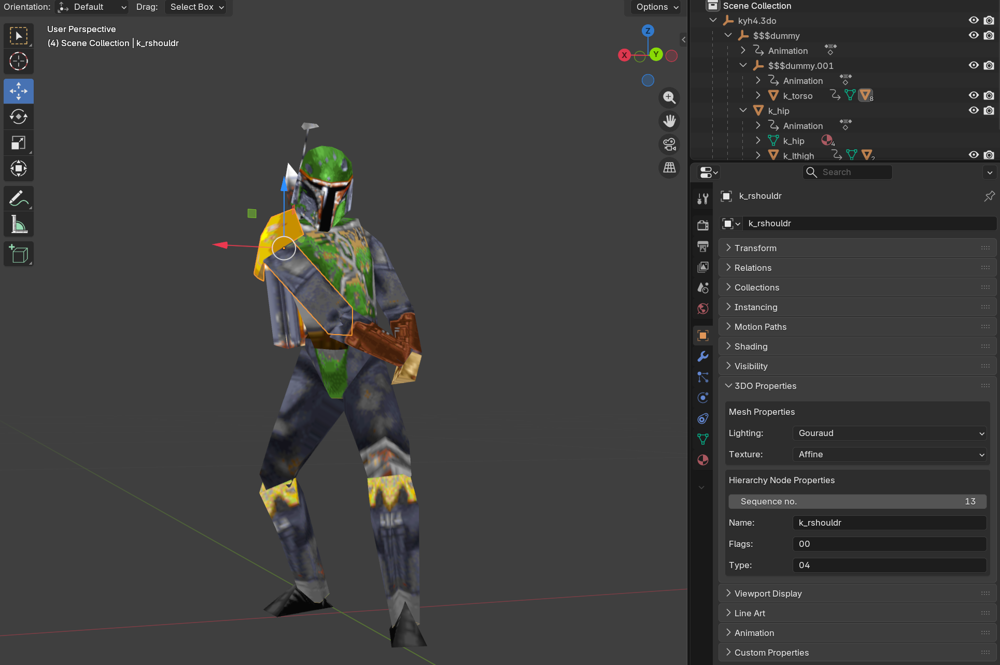
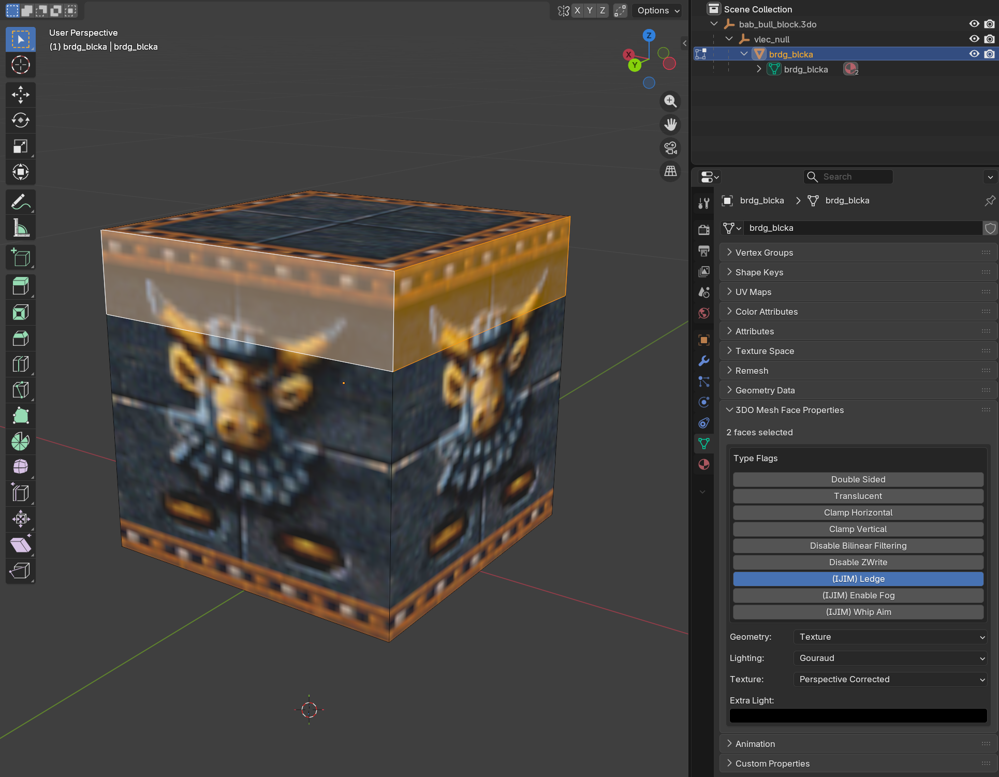

# 📖 Usage Guide

Complete guide for using the Sith Engine Toolkit add-on for Blender 5.0.

---

## 📥 Importing 3DO Models

**Menu**: `File > Import > Sith Game Engine 3D Model (.3do)`

### Import Options

| Option | Description |
|--------|-------------|
| 🎥 **Adjust 3D View** | Auto-frames model with optimal camera distance |
| 🧹 **Clear Scene** | Clears all scenes and their content in the current `.blend`, not just the active scene |
| 📐 **3DO 2.1 - Absolute UV** | Converts absolute to relative UVs (JKDF2/MOTS) |
| 🎨 **Import Vertex Colors** | Imports per-vertex color data |
| ⭕ **Import Radius Objects** | Creates wireframe sphere objects for radii |
| 📋 **Preserve Mesh Hierarchy** | Prefixes Blender object names with source node indices |
| **Try Recover Broken File** | Opt-in best-effort recovery; located immediately before the texture settings and off by default |
| 📁 **MAT Directory** | Folder path for `.mat` texture files |
| 🎨 **ColorMap File** | Path to `.cmp` file (JKDF2/MOTS) |

> **Clear Scene is enabled by default.** It clears scene content throughout the
> current `.blend` file, including other scenes. Disable it to import alongside
> existing work. It does not delete the original asset files on disk.

Linked scenes are discarded as scene datablocks rather than editing their
read-only collections or animation; their source `.blend` libraries are unchanged.

**Adjust 3D View** preserves the previous selection, active object, perspective
mode and object-view lock after framing. It is skipped outside Object Mode and
in background sessions or layouts without a usable viewport. If a viewport
operator fails, the model remains imported and a warning reports the framing
failure; retrying the resource import is not necessary.

**Resource search:** MAT files are searched beside the model, in that directory's
`mat` subdirectory, in the parent directory's `mat` subdirectory, then in the
explicit **MAT Directory**. A relative MAT Directory is relative to the model.

For CMP files, the explicit/current-directory path is checked first. Fallbacks
are the model directory, its `misc/cmp` subdirectory, the parent directory, the
parent's `misc/cmp`, then the grandparent's `misc/cmp`. An empty **ColorMap File**
uses `dflt.cmp`.

File and directory components use exact spelling first, then a case-insensitive
fallback on the actual resource volume. This also finds `MAT`, `MISC/CMP` and
`DFLT.CMP` on case-sensitive disks or network shares. If multiple case variants
match without an exact spelling, lookup reports an ambiguity instead of choosing
an arbitrary resource; specify its exact spelling to resolve it.
An unavailable or ambiguous optional MAT produces a warning while other search
folders are tried; the model can still import without that texture.

### Recovering Invalid Files

Enable **Try Recover Broken File**, immediately above the texture settings, to
retain usable parts of a damaged model.
After a syntax error, parsing stops and retains only completed records. Completed
meshes and vertices survive even when later UVs, faces or hierarchy data are missing.
A mesh with no recovered faces contains vertices only; enter Edit Mode to inspect
them. Recovery does not infer the missing surfaces.

When recovery is enabled, faces with invalid vertex references or fewer than three
corners are omitted. Safe repeated corners, zero-area faces and duplicate surfaces
are retained, including their winding and UV corners. Invalid active UV
corners receive placeholder `(0, 0)` coordinates while
valid UVs are preserved. Missing vertex lighting uses black, and Blender computes
normals from the available geometry. Missing mesh references become empty nodes.
Broken parent links are detached; meshes without recovered nodes are placed at
the origin. Missing original transforms and pivots cannot be reconstructed.
This fallback applies to missing/partial hierarchies or broken mesh bindings.
A complete, nonempty hierarchy with valid bindings may intentionally leave
mesh-table entries unused; enabling recovery does not create extra joints or
reveal that unused geometry.
Some partial hierarchies recover as multiple roots for inspection; export reports
a hierarchy error until the structure is repaired rather than inventing a parent.

Blender shows a recovery notice with a **View Import Report** button. Clicking it
opens the full report in a separate Blender window without replacing your model
viewport. The same button is available under **Object Properties > 3DO Properties**
when the recovered model or one of its descendants is selected.

The report is stored inside the `.blend` file as `<model> - Import Report`, not as
an external text file. The button opens Blender's built-in Text Editor and selects
that report automatically. Close the report window to return to the model.
Review the report and repair the model before export: recovery is not a repair,
and exporting can retain placeholder UVs or incomplete geometry.

The source file is never modified. Unsupported versions and invalid format headers
remain errors, as do files with no recoverable geometry or hierarchy. Strict import
remains the default and requires one HEADER, MODELRESOURCE, GEOMETRYDEF and
HIERARCHYDEF section in that order, nonnegative counts and safe references.
Complete empty resources are valid; missing sections are not empty resources.
Recovery can retain completed geometry from an incomplete body and reports the
missing sections. Zero-area
faces and repeated corners in original game assets, including whip models, import
normally without **Try Recover Broken File**. Repeated corners get separate
coincident Blender vertices, preserving each face, UV corner, normal and vertex
color without invalid self-linked topology. The core codec retains the original
vertex-index records; Blender export may renumber those coincident vertices.
Recovery also sanitizes nonfinite UV-table entries, including unused coordinates,
without changing valid UV indices. Parsing and reference checks run before **Clear Scene**, but
that option still intentionally discards existing scene content once import starts.

---

## 📤 Exporting 3DO Models

**Menu**: `File > Export > Sith Game Engine 3D Model (.3do)`

### Export Options

| Option | Description |
|--------|-------------|
| 🎯 **Version** | 2.1 (JKDF2/MOTS), 2.2 (IJIM RGB), 2.3 (IJIM RGBA) |
| 📐 **Absolute UV** | Fixed UV coordinates (2.1 only) |
| 🎨 **Export Vertex Colors** | Includes vertex color data |
| 🔄 **Sync Mesh List** | Aligns mesh sequence with hierarchy nodes |

3DO exports preserve long names and report legacy compatibility warnings in the
export UI and console. They do not truncate names or block export for length.
For 2.1, warnings begin above 31 characters; for 2.2/2.3, filename/material/mesh
names allow 63 characters and hierarchy names allow 127 before a warning.
Illegal identifier characters still fail because they would break the text format.
The Blender hierarchy-name property retains the full source identifier without
the old 64-byte storage cap, independently of Blender's object display name.
Names with a shared long prefix therefore remain distinct after import/export
and `.blend` storage. KEY target name limits still apply separately.

3DO numeric fields are written without fixed-decimal truncation, so small nonzero
geometry, UVs, lighting and radius values remain nonzero. Nonfinite values and
values outside finite float32 storage fail before replacing an existing export.

The Blender importer creates **LOD 0 only**, and export writes that edited geoset.
Additional source LODs are not retained or recreated. The core resource codec can
parse/write multiple geosets, but this is separate from the Blender workflow.

### Export Selection

Both 3DO and KEY export use the **active selected Mesh or Empty** and its complete
model hierarchy. Selecting a joint resolves its top-level Mesh/Empty parent;
unselected joints in that model are included. Other selected models are ignored,
not merged or batch-exported. Collection names, including `Model3do`, have no
special role. With no active selected object, export cancels without writing.
The model's parent chain must belong to the active view layer. Unsupported parents
must be baked or reparented first, rather than silently dropping their transforms.
Selections with no exportable joints, such as an orphaned radius helper or a
wrapper containing only helpers, cancel before creating or replacing a file.
Selecting an owned helper still resolves its real model. Meshless joints and
skeletons without animated tracks remain valid; the core codecs also retain
support for complete empty resources independently of Blender export selection.

---

## 🎬 Importing KEY Animations

**Menu**: `File > Import > Sith Game Engine Animation (.key)`

### Steps

1. 📦 **Import the 3DO model** first
2. 📂 **Select the `.key` file**
3. ⚙️ **Configure options**:
   - ✅ **Validate**: Checks for required animation nodes
   - 🧹 **Clear scene**: Removes existing animation data
   - 🏷️ **Import markers by name**: Uses marker type names instead of numeric type IDs

> 💡 **Tip**: Match KEY files to 3DO models using puppet files (`.pup`) in the `misc/pup` folder, or compare node names between `.3do` and `.key` files.

---

## 🎬 Exporting KEY Animations

**Menu**: `File > Export > Sith Game Engine Animation (.key)`

### Export Options

| Option | Description |
|--------|-------------|
| 🚩 **Flags** | Animation behavior (loop, pause, fade, etc.) |
| ⭐ **High Priority Nodes** | Hex value for priority nodes (default `0xFFFF`) |
| 🎞️ **Frame Rate** | Numeric playback FPS, including fractional rates; initialized from the scene's effective rate |

An untouched scene uses priority mask `FFFF`; importing a KEY retains that file's
mask, including zero. Scripted exports inherit the scene mask unless `node_types`
is explicitly supplied. An explicit zero overrides the scene; clearing the hex
field resets it to its declared default. New hierarchy joints use type `01`, while
imported types are preserved. Reading a default does not create a stored override.

Hex fields retain all mask digits, including high bits in 3DO joint flags/types
and KEY priority masks; they are not restricted to four hex digits.

The KEY **Flags** controls edit known bits only. Unknown/custom engine bits are
retained separately and survive `.blend` storage, known-flag edits, and both dialog
and scripted exports (including explicit `flags` overrides). **Clear scene** on
KEY import replaces both known and unknown flags with the incoming file's values;
a merge import retains the scene's existing flags and priority mask.
Scripts can explicitly discard extension bits by deleting the scene's
`_sith_key_unknown_flags` custom property or setting its hex string to `"0"`.

### Animation Fidelity

KEY stores Euler rotations and per-frame position/rotation deltas. Imported tracks
use the shared KEY Euler order with linear or constant interpolation, retaining
authored winding and full turns instead of converting everything to quaternion
shortest paths. Effective FPS includes Blender's `fps_base` value.

The export dialog preserves numeric/fractional scene rates within Blender's
playback limits instead of rounding them to a preset. Playback settings and flags
are saved to an editable scene only after a successful export; validation and
output errors leave those scene settings unchanged. Exporting a linked/read-only
scene remains supported, but overrides affect only the exported KEY. Its source
FPS, flags and priority mask remain unchanged, including after save/reopen.
Scripted `EXEC_DEFAULT` exports resolve the selected model without requiring the
file browser and retain scene metadata unless explicit overrides are supplied.
KEY import validates every destination joint and its Pivot constraint before
clearing existing actions or markers.
Scripted `importKey` calls must pass the current context scene. To import into
another scene, activate it or supply a matching Blender scene/view-layer context
override first. Model roots and eligible joints must all belong to that scene;
parenting alone does not establish scene membership. These checks also apply with
**Validate** disabled and run before clearing or merging any animation.
Every nonempty track must start at frame zero in float32 storage, as required by
Sith playback. A later first entry is rejected, not silently held or retimed;
empty tracks remain valid and do not create animation channels.
Complete and partial skeleton matching use only actual Mesh/Empty joints. The
model wrapper, radius helpers and unsupported subtrees cannot stand in for a
missing joint through either index or name matching. With **Validate** enabled,
a missing required joint fails before clearing animation; with it disabled, only
matched joints receive channels.
Partial-name matching is one-to-one: distinct source tracks cannot resolve to
the same Blender joint through duplicate names, case variants or display-name
aliases. Such imports fail before modifying animation, including with
**Validate** disabled. Assign distinct joint sequence numbers to disambiguate a
partial skeleton; complete numbered skeletons may still use repeated mesh names.
When importing without **Clear scene**, joints sharing the same action slot
receive independent action copies before their channels are merged. Other users
keep their animation; distinct slots in one action can remain shared. Existing
keys outside incoming sample times remain intact.
An action slot reused by the same object's NLA clips is also copied before a
merge, including muted clips and clips nested in Meta strips. Those clips retain
their original source curves; the new keys belong to the active action only.
Linked library actions are copied to editable local actions before a merge,
even when they have only one user; the library's channels and file stay unchanged.
Joint objects receiving nonempty tracks must themselves be local/editable.
The destination scene must also be local/editable, even for empty KEY tracks,
because import updates its timing and markers. **Clear scene** rejects any
read-only animated object in that scene, including unrelated linked objects and
driver-only animation, before clearing local actions or markers. Make those
objects local/editable or disable **Clear scene** to leave their animation alone.
Unanimated linked objects do not prevent clearing animation, and editable objects
may detach linked actions without modifying the library's source curves.
A merge cannot change the rotation interpretation of existing animation: active
quaternion, axis-angle or other-order Euler animation must first be baked to the
KEY Euler order (`YXZ`). Such merges fail before changing curves, actions or scene
timing. The same restriction covers non-native driven/NLA rotation. **Clear scene**
can instead replace the existing animation; a static non-native rotation without
active rotation animation does not prevent import.
Globally disabled NLA evaluation (`use_nla=False`) is treated like muted tracks
or strips during this merge check. Its original clips/actions remain unchanged;
the active action's own rotation channels must still use the supported order.
Empty KEY tracks do not change a joint's rotation mode or existing channels.
Active transform drivers on a matched, nonempty track must be muted or removed
before merging a KEY, even for joints already using `YXZ`. Otherwise they would
override the imported keys. Such conflicts fail before actions, markers or timing
change. Muted drivers and unrelated property drivers may remain. **Clear scene**
removes existing animation data, including conflicting drivers, before importing.
With NLA evaluation enabled, a populated unmuted track requires the active action
to use **Replace** with full influence before merging. Other blend settings can
attenuate or add to imported poses, even if the NLA strip itself is muted. Disable
NLA, mute its tracks, restore those action settings, or use **Clear scene**.
Exit NLA tweak mode before a merge: Blender makes the action binding read-only
and remaps its time in that mode. The check runs before copying any joint action.
**Clear scene** can replace that animation instead. When merging, empty incoming
tracks leave the existing tweak action untouched.
Sampled transform curves must be converted to editable keyframes before a merge;
raw KEY insertion must not mix Blender's sample and keyframe storage. Muted
destination transform curves must be unmuted, and active transform F-curve
modifiers must be muted or removed, so the new keys can actually drive the joint.
These checks run for every nonempty destination before anything is changed.
Unrelated custom-property curves and muted modifiers may remain. **Clear scene**
can replace these incompatible curves instead of merging into them.
Pivot offset, influence and mute animation must also be baked before a merge,
including drivers and active constraint-only NLA clips. A Pivot that is disabled
at the current frame may become active later, so its current pose alone is not
sufficient. Permanently muted/zero-influence constraints, muted channels/drivers
and globally/individually disabled NLA may remain. Empty incoming tracks do not
alter these settings. **Clear scene** removes their old animation before import;
the remaining static Pivot must still satisfy the normal import restrictions.
KEY files require one `HEADER` and one `KEYFRAME NODES` section, in that order.
The optional `MARKERS` section belongs between them. Missing/duplicate sections,
negative counts and duplicate/out-of-range joint indices are errors, not empty
animations. Decimal numbers accept leading `+` and trailing decimal points,
including forms such as `+.5`, `1.` and `1.e2` in both KEY and 3DO resources.
Imports preflight float32 data before clearing existing work. 3DO import also
checks rebuilt vertex/hierarchy transforms; KEY import checks extrapolated samples
and destination Pivot-adjusted local positions before assigning RNA values.
KEY durations, marker positions and FPS must fit Blender's actual storage/playback
limits. Unsupported rates/ranges fail before clearing animation or replacing an
export file, rather than being silently clamped. FPS conversion uses a bounded
integer rate plus a float32 base, with relative rate precision of `1e-7`.

KEY export computes per-frame slopes with wider intermediate arithmetic and
rejects nonfinite or out-of-float32-range stored values before opening the output.
Floating-point fields use round-trip-safe text, including exponent notation,
rather than fixed decimal places. Small deltas therefore remain nonzero, and
long segments do not acquire drift from rounding their stored slopes.

Export evaluates complete location/rotation F-curves, including unkeyed components and
keys at fractional frames. Quaternion and axis-angle rotations use continuous
Euler branches. Nonlinear curves are adaptively baked, so their exported KEY may
contain additional entries. Details and tolerances are in [tests/README.md](tests/README.md).
Quaternion and axis-angle baking also sample component zero crossings and turning
points. This preserves signed quaternion travel and catches rapid changes while
normalizing a near-zero axis, so a narrow turn between ordinary probes cannot
silently disappear. A zero axis with a nonzero angle is rejected; a zero angle may
use a zero axis. Quaternion and axis-angle channels must use LINEAR, CONSTANT or
BEZIER interpolation; bake other easing types first. Curves that exceed the bake
depth or float32 frame precision report an error before replacing the previous
export, not a silently flattened pose.

Bake live constraints (except the format's pivot constraint), F-curve modifiers,
transform drivers, NLA composition and overlapping action layers to ordinary
location/rotation channels or sampled curves before export. Live modifiers are
rejected because fixed sample probes can miss entire oscillations. Muted F-curve
modifiers do not affect the exported animation and may remain. Unsupported live
inputs report an error rather than silently changing the animation. Animated
scale is not part of KEY and must be removed or redesigned; delta motion must be
baked into ordinary location/rotation channels.
Globally disabling NLA evaluation or muting its tracks leaves ordinary action
export available. Muted strips, including Meta strips with only muted descendants,
remove their clip poses but can still enable the active action's blending.
With a populated unmuted track, export therefore requires **Replace** with full
action influence, even when every strip is muted. Exit NLA tweak mode before
export as well. These checks apply to joints and the model wrapper; live NLA
composition still requires baking. Rejected exports preserve the existing file
and do not change mute/evaluation settings or action bindings.
KEY export also checks animation and drivers on constraint properties, including
Pivot offsets, influence and mute state. A constraint that starts at zero influence
or muted can still affect later frames; bake that motion before export. Other
animated settings may remain only behind a fixed, unanimated disabled gate: a
permanently muted constraint or zero influence that cannot be activated by its curves
or drivers. Muted constraint channels and unrelated custom-property animation are
not treated as live constraint motion. Static 3DO export still captures the current
supported Pivot pose.
The top-level EMPTY model wrapper is not a KEY joint. Bake its transform
animation, transform drivers and NLA motion onto joints before KEY export.
Muted wrapper curves/tracks and non-transform custom-property animation are
allowed; a mesh root remains an ordinary animatable joint.

The KEY export dialog's **Target** validates joint/marker counts and name
buffer limits. Infernal Machine is the default (64 joints, 16 markers,
63-character names). JKDF2 and MOTS use 64 joints, 8 markers and 31-character names.
**Generic** does not impose those engine-specific limits; select it
for another engine such as DroidWorks only after checking that engine's limits.
This opts out of engine-specific validation, not all validation. Shared KEY name
validation still allows at most 64 characters, and structural/numeric safety
checks remain enabled for every target.
Shared unquoted-token validation still applies. Names cannot contain whitespace,
control characters, quotes or `#`.
The 3DO mesh display `NAME` is a whole-line field and may contain spaces; it is
validated separately from hierarchy names and KEY joint identifiers.

For existing incorrectly exported animations, re-export the original Blender
action or re-import the original KEY first. A full turn encoded in an already
corrupted KEY cannot safely be distinguished from an intentional full turn.

Blender evaluates keys within `0.0001` frames as the same key. Moving KEY segments
that end in a jump therefore use a small pre-boundary hold for preview. The exact
source segment is retained for export only while its action, transform curves,
interpolation and pivot remain unchanged. Editing them switches export to the
edited Blender curves. This prevents a correct export from hiding a wrong pose at
the jump itself, but does not make arbitrarily close subframe evaluation exact.
Jumps too closely spaced for Blender's frame precision report an error.
This includes held pose changes, not just moving segments. Checks use stored
float32 times and channels, and also cover nearby existing destination keys in a
merge. Equal stored poses may remain close together, but times that collapse to
one float32 frame are rejected. Failures occur before actions, markers, playback
settings or current poses change.

Timeline markers are integer-valued and cannot store custom properties. Fractional
KEY timing is retained in the marker name, for example `LeftFoot@0.1` at frame 2
exports at frame 2.1. Moving or duplicating that marker retains its fractional
offset. Integer markers keep their ordinary names.
Export sorts markers by their actual fractional time, preserving the order of
simultaneous events. This is required by the engine's chronological event scan.

> **KEY Filename Limit**: 31 characters for JKDF2/MOTS, 63 for IJIM.

---

## 🖼️ Importing MAT Textures

**Menu**: `File > Import > Sith Game Engine Texture (.mat)`

### Steps

1. 📂 Select the `.mat` file
2. 🎨 (Optional) Specify ColorMap `.cmp` for JKDF2/MOTS
3. ✅ Click `Import MAT`

Reloading a MAT updates its existing local image datablocks so other materials sharing
those images stay connected. Invalid palette indices and truncated records are
rejected before replacing the loaded material's nodes or pixels.
For an editable material whose cel images remain linked or non-editable, reload
first creates local image copies and updates that material's bindings. The source
library images and their other users stay unchanged, and the new pixels and
dimensions survive saving and reopening the `.blend` file. Subsequent reloads
reuse those local copies, including when other local materials share them.
If the material itself is linked/read-only, reload instead reports an error before
changing nodes, image bindings or pixels. Make that material local/editable first;
the importer does not replace a library material or remap its other users for you.
MAT import currently supports format version 50. Older version-10 resources and
empty/truncated files report errors; their missing or unsupported contents are
not automatically reconstructed.
Incomplete CMP headers and palette data produce a controlled import error before
any existing material nodes or image pixels are replaced.
Cel images are bound to their material rather than found by display name. An
unrelated image with the same name is not modified, and renaming a bound image
does not break reloads. These bindings are retained when saving a `.blend` file.
If the reloaded file has fewer cels, obsolete numbered cel bindings are removed.
Their image datablocks are not deleted or overwritten: other materials may still
use them. A later reload that adds those cels creates new bindings and images.
If an indexed MAT's palette is unavailable, all its cels become generated UV-grid
placeholders, including cels that previously held packed pixels. Reloading with
the palette restores real pixels in the same image datablocks, retaining shared
material connections. The missing-palette reload does not unpack files to disk.
Packed 16-bit RGB/alpha channels use their full normalized range. White reaches
1.0 in RGB565/RGBA1555/RGBA4444, and maximum RGBA4444 alpha is fully opaque.

---

## 🎛️ Editing 3DO Properties

3DO export synchronizes live Edit Mode geometry, UVs and face properties without
leaving Edit Mode, including when multiple mesh objects are being edited.
Active non-Pivot constraints must be baked into ordinary transforms before 3DO
or KEY export. They are rejected rather than silently exporting a different pose.
Apply visible mesh modifiers before 3DO export; unapplied effects report an error
instead of silently exporting the unmodified mesh. Hidden modifiers are ignored.
KEY export reads only the joint hierarchy and does not require applying geometry
modifiers.
Bake active shape-key deformation into the mesh before 3DO export. This includes
pinned shapes and absolute shape-key animation; zero-weight or muted relative
keys may remain. KEY's geometry-independent transform export is unaffected.

Collection instances and vertex/face instancing are not ordinary mesh/joint data.
Make their instances real, arrange the resulting objects into the model hierarchy
and disable the instancing mode before 3DO or KEY export. Active instancing is
rejected before replacing an output file, including instancers nested in otherwise
unsupported branches. Ordinary objects sharing mesh data remain supported, as do
objects whose instance mode is disabled.

Mesh geometry mode is independent of viewport display type. In particular,
vertex-only mode remains vertex-only even though Blender previews it as wireframe.
The importer retains signed/HDR vertex lighting values in float color attributes.
Export reads linear color values from either float or byte attributes.
Material references and texture dimensions come from each object's effective
material slots, including object-linked overrides on a shared mesh. Data-linked
slots still use the mesh's material, and an empty object override stays unassigned
instead of falling back to it. Export does not modify shared mesh materials.

Missing MAT images do not remove material references. Legacy pixel-sized UVs are
retained in their original units; converting between pixel and normalized units
requires the image dimensions. If the image is unavailable, conversion reports an
error instead of guessing. Re-import the model after resolving missing textures
to normalize its UVs for Blender preview. Invalid active UV indices are rejected
unless **Try Recover Broken File** is explicitly enabled.
Legacy 3DO import uses the same image-resolution rules as export. If an existing
material's color graph is ambiguous or its image has no dimensions, import keeps
the original pixel UVs and reports a warning instead of choosing the first image
node. Export in unchanged pixel units preserves those coordinates; conversion to
normalized units still requires a resolved image. Bind MAT cel 0 or simplify the
material, then re-import to normalize the Blender preview.
UV-unit conversion uses the material's explicit MAT cel-0 image binding when
present. Otherwise it follows the active output's color texture, ignoring unused,
normal and roughness images when a color image is identified. A single unconnected
image remains a legacy fallback, including an empty legacy color-image node.
Multiple color images, node groups or a procedural color
without a resolvable image require an explicit binding or simpler material;
conversion does not guess from node order. This selects dimensions only, not
texture/material baking or MAT export. Export without UV-unit conversion does
not require resolving image dimensions.
An unresolved group/shader branch also requires a binding when another branch
contains a known image. Finding that image does not establish the dimensions of
the whole color graph, and an error leaves the previous export file unchanged.

Face normals are recomputed from geometry, not forced to match potentially invalid
source normals. Export accounts for nonuniform scale and reverses corner winding
for mirrored meshes. Coincident vertices with different computed lighting normals
or colors remain separate, preserving normal and color seams. Matching position,
normal and color values may still share an exported vertex.
Normal scaling is normalized before float32 storage so very small or large
finite scales do not erase valid directions. Flattened meshes retain their
cofactor normals; fully collapsed or already-zero normals stay zero.
Authored custom corner normals and explicitly sharp edges are retained, including
split lighting seams and applied normal modifiers. Faces still receive geometric
normals. Meshes without custom normals or explicitly sharp edges retain geometric
vertex lighting rather than adopting flat corner
normals merely because Blender's polygons are marked flat.
Imported model radii are retained even when smaller than the
visible model: the engine can use them for collision defaults. Their values are
stored on the model root even without radius helpers, and deleting a helper does
not discard that stored radius. Scaled or edited helpers are respected in all
rotation modes. Only mesh bounds are enlarged to contain their geometry. Invalid
or off-center radius helpers report an error. New models without an authored
radius receive an initial geometry-based estimate.
Radius helpers are resolved under their owning object, including shared-mesh
instances with hierarchy prefixes. Renaming newly imported helpers is supported;
multiple helpers of the same kind under one owner are rejected as ambiguous.
The `_sith_radius_kind` marker identifies newly imported helpers independently of
their names. Unmarked legacy helpers must start with `MESH_RADIUS_` or
`MODEL_RADIUS_`; those leading prefixes remain reserved for helpers. The same
text elsewhere in an ordinary joint name does not make it a helper or exclude
its geometry or animation from export.
Radius helpers must be centered mesh objects with ordinary object parenting.
Apply/bake active helper constraints, visible modifiers and shape-key deformation
before exporting 3DO bounds; otherwise export reports an error rather than storing
the unchanged sphere radius. Hiding the helper itself does not bypass these checks.
Muted/zero-influence constraints, hidden modifiers and harmless relative shape keys
may remain. Direct scale, baked mesh edits and live Edit Mode edits remain supported.
KEY export does not inspect these geometry-only bounds helpers.

### Pivot Compatibility

3DO and KEY export share the same Pivot constraint rule: muted constraints and
zero influence are ignored; active constraints must have full influence. Partial
influence reports an error. This also applies when importing KEY positions onto
objects with Pivot constraints.
Static 3DO export resolves evaluated world-space Pivot targets, including a
target's parent transforms and constraints. Relative and absolute world-space
pivots are supported under translated, positively uniformly scaled parents.
Rotated/nonuniform parents, other constraint spaces, bone targets and stacked
Pivot constraints must be baked first. Static rotation-range gates are respected.

KEY import/export requires relative target-free pivots. World-anchored targets
or absolute pivots must be baked into ordinary channels first. For KEY export,
animated rotation with a conditional Pivot gate requires baking or an `Always`
rotation range; animated parent rotation with a Pivot also requires baking.
KEY import requires `Always` for active destination Pivot constraints, since it
creates rotation channels. Conditional gates and incoming parent rotation are
rejected before replacing or merging any animation.
Merges also check existing rotation drivers and active NLA on every ancestor of
a Pivot-constrained joint. Those must be baked or disabled first. Muted drivers,
inactive NLA and translation-only parent motion remain supported. **Clear scene**
may remove the old procedural motion instead when the initial Pivot is representable.

Import intentionally bakes each 3DO node's pivot offset into its mesh vertices so
the model can be edited directly in Blender. The original offsets are not retained
for automatic reconstruction on export; imported objects normally export with
zero pivots. This can preserve visible geometry and animation without preserving
the original mesh coordinate frames.

Engine joint matrices can therefore have different translation components after
export. In IJIM, this can affect mesh attachments or scripts using
`GetThingJointPos`, even when the model looks and animates correctly. Check these
uses in the target game when replacing a model that originally had nonzero pivots.
Exact preservation would require an export-aware, visually editable pivot workflow;
the current importer does not provide one.

### Unapplied Transforms

Only ordinary object parenting is represented by the exported joint hierarchy.
Vertex, triangle-vertex, bone and other parenting modes must first be baked or
converted to object parenting while preserving the visible pose. Both 3DO and KEY
export reject them before replacing an existing output file.

Before 3DO or KEY export, bake/apply parent-inverse compensation and delta
transforms into ordinary channels/geometry while retaining the visible pose.
Apply rotation on the model wrapper as well. These unapplied states now report
errors instead of producing a model different from Blender's displayed pose.
Local mesh scale and uniform parent scale remain supported. Nonuniform parent
scale is supported only when it commutes with the child rotation; apply it before
exporting rotated children or animated rotations that would otherwise need shear.

### Hierarchy And Mesh Order

Exported joints must be Mesh or Empty objects. Cameras, lights and other
unsupported objects may remain as nonmodel leaves/branches. If such a parent
contains a Mesh or Empty joint, 3DO and KEY export stop with an error before
opening the output file instead of silently omitting that subtree. Bake or
reparent those joints into a Mesh/Empty hierarchy while retaining their visible
transforms and animation. Radius helpers remain excluded from the joint hierarchy.

Hierarchy node ordering follows **Sequence No.** values independently of mesh
numbering. Automatic roots remain first, and ambiguous sequence numbers that
cannot produce a root at node 0 report an error instead of exporting a partially
unreachable hierarchy.
KEY import uses the same normalized hierarchy order for a complete matching
hierarchy, including automatic and sparse authoring sequence values. Partial
hierarchies retain explicit-index/name fallback; ambiguous matches report errors.

With **Sync Mesh List** disabled, mesh numbering follows the exporter's traversal
of Blender objects. With it enabled, meshes are reordered to follow hierarchy node
order. Each node still references its correct mesh in either mode. Empty nodes do
not consume mesh slots, so mesh and node numbers need not be identical even with
sync enabled. Original game mesh-table numbers are not guaranteed by either mode.

### Vertex Colors

With **Import Vertex Colors** disabled, no color layer is created. With
**Export Vertex Colors** disabled, the engine's default opaque black vertex color
is written instead of exporting an empty or uninitialized Blender attribute.

Vertex colors on faces use the active color attribute. Face extra lighting is
independent of the vertex-color options. Imported models with loose vertices
also keep a `3do_loose_vertex_colors` POINT attribute, since a face-corner layer
cannot store colors for vertices without faces. Mixed meshes keep their CORNER
layer active; vertex-only meshes use the POINT layer. The POINT values are
editable, survive `.blend` storage, and preserve signed/HDR float colors. Selecting
a POINT attribute explicitly makes it the source for all exported vertex colors.
The target format still applies: 2.1 stores scalar intensity, 2.2 stores RGB, and
2.3 stores RGBA.

The add-on provides custom UI panels for editing 3DO-specific data directly in Blender.

### 🎯 Object 3DO Properties

**Location**: `Properties Panel > Object Properties > 3DO Properties`

#### Available Properties

| Property | Description |
|----------|-------------|
| Geometry Mode | Engine mesh mode, independent of Blender viewport display |
| 💡 **Lighting Mode** | In-game lighting (Gouraud, Flat, etc.) |
| 🖼️ **Texture Mode** | Mapping mode (Perspective Corrected, Affine) |
| 🔢 **Sequence No.** | Node position (-1 = auto-assign) |
| 🏷️ **Name** | Node name (defaults to object name) |
| 🚩 **Flags** | Node behavior flags (hex) |
| 🎯 **Type** | Node type identifier (hex) |

---

### 🔷 Mesh Face Properties

**Location**: `Properties Panel > Data Properties > 3DO Mesh Face Properties`  
**Mode**: Edit Mode with Face Select enabled

#### Type Flags
- ↔️ **Double Sided** - Renders both sides
- 🌫️ **Translucent** - Alpha blending enabled
- 📏 **Clamp Horizontal/Vertical** - Texture clamping
- 🚫 **Disable Bilinear Filtering** - Point filtering
- 📺 **Disable ZWrite** - Depth buffer control
- 🧗 **IJIM: Ledge** - Climbable surface
- 🌁 **IJIM: Enable Fog** - Fog rendering
- 🔗 **IJIM: Whip Aim** - Whip target spot

#### Modes
- 📐 **Geometry Mode**: Not Drawn, Wireframe, Solid Color, Texture
- 💡 **Lighting Mode**: Fully Lit, Flat, Gouraud, Gouraud + Vertex Colors
- 🖼️ **Texture Mode**: Affine, Perspective Corrected
- 🔦 **Extra Light**: Additional RGBA lighting

> ⚡ **Multi-face editing**: Select multiple faces and change only the properties you need - other values are preserved!

Toggling a known face flag changes only that bit. Unknown/custom engine flags,
including high bits, and each selected face's other flags are preserved.

Face **Extra Light** accepts signed/HDR values throughout finite float32 storage.
The normal slider range is `[0,1]`, not a storage limit. Synchronizing the panel
and editing one color component do not clamp the other components. The output
version still determines whether face lighting is scalar (2.1), RGB (2.2) or
RGBA (2.3).

---

## 🔧 Troubleshooting

### ❌ File path validation errors

All import/export operators validate file paths. 
- ✅ Ensure you've selected an **existing file** for import
- ✅ Ensure you've selected a **valid directory** for export
- ✅ Check file extensions (.3do, .key, .mat)

### 🎥 "Adjust 3D View" doesn't work

This feature requires an active 3D View area.
- ⚠️ Skipped automatically in headless/background mode; model import still completes
- ⚠️ Skipped in custom layouts without a usable window, screen or 3D viewport
- ✅ Ensure you have a 3D View visible when importing

### 🖼️ Missing textures after import

Textures not showing up?
- 🔍 Use **"MAT Directory"** option to explicitly point to your texture folder
- 📁 Check the default search locations are correct
- ✅ Ensure `.mat` files exist in the specified directory

### 🎨 Face property changes not applying

Can't edit face properties?
- ✅ Ensure you're in **Edit Mode**
- ✅ Enable **Face Select** mode (hotkey: 3)
- ✅ Have at least one face **selected**

---

[← Back to README](README.md)
