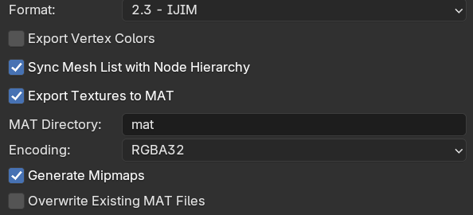
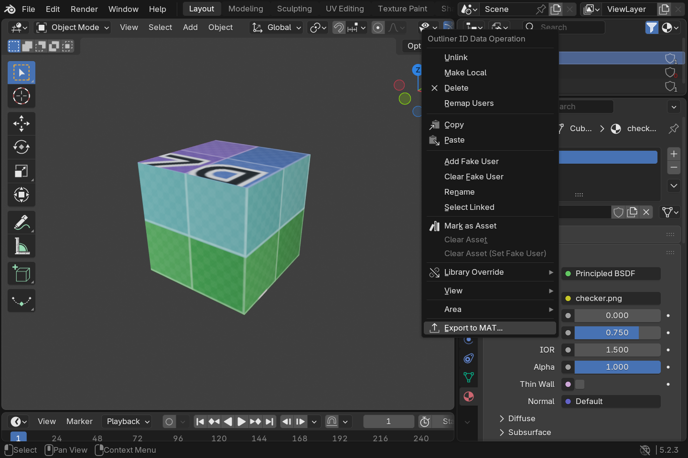
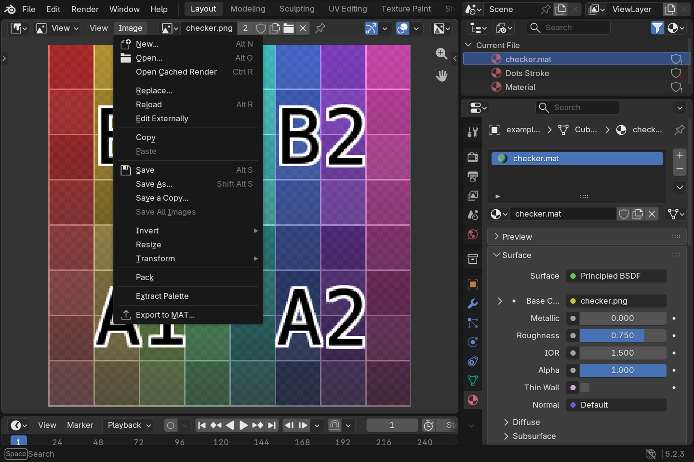
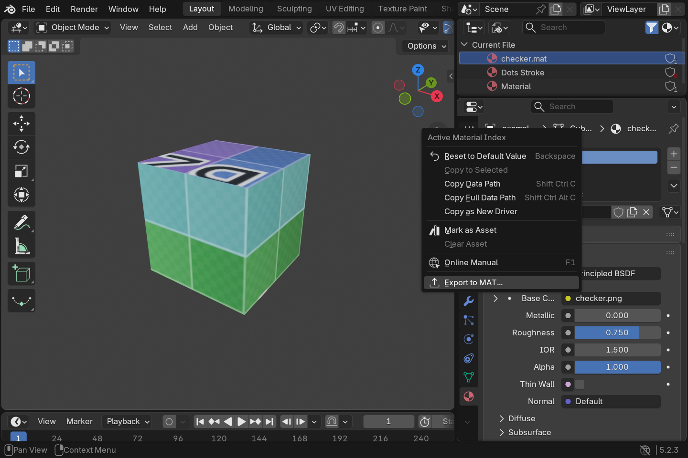
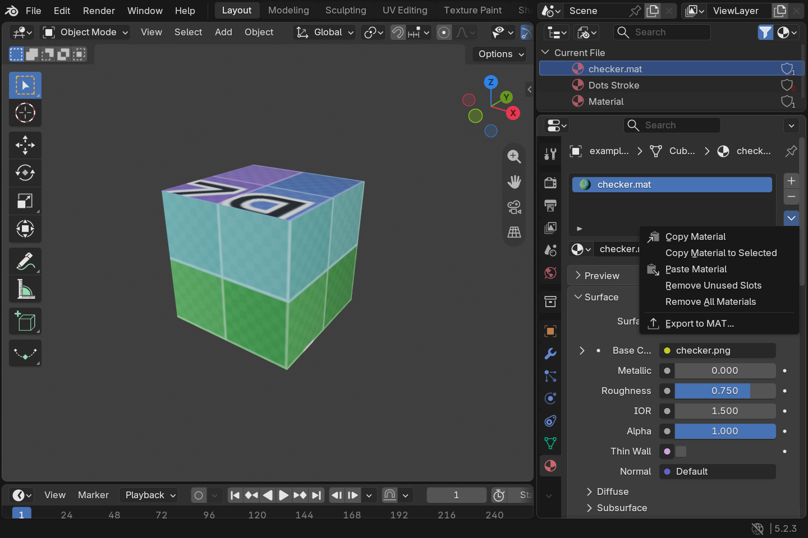
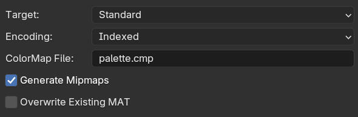
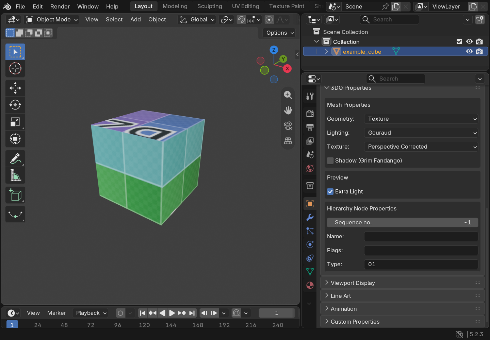
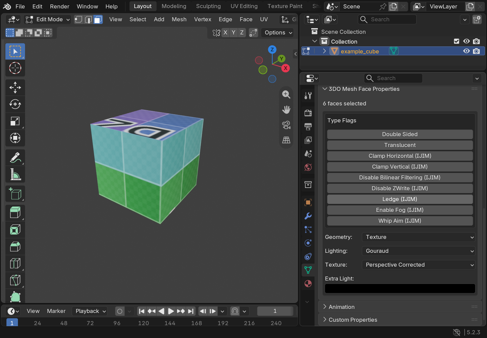

# 📖 Usage Guide

A quick guide to importing, editing and exporting game models, animations and textures.

## 📑 Contents

| Workflow | Jump to |
| --- | --- |
| 📦 **3DO Models** | [Import](#-importing-3do-models) · [Import options](#import-options) · [Export](#-exporting-3do-models) · [Export model textures](#exporting-model-textures) |
| 🎬 **KEY Animations** | [Import](#-importing-key-animations) · [Export](#-exporting-key-animations) · [Targets](#target-choices) · [Flags](#flags-menu) · [Priority mask](#high-priority-nodes) |
| 🖼️ **MAT Textures** | [Import](#-importing-mat-textures) · [Export](#exporting-mat-textures) · [Export options](#mat-export-options) · [Encodings](#encodings) |
| 📤 **MAT Export Locations** | [Outliner](#outliner) · [Image Editor](#image-editor) · [Material Properties](#material-properties) |
| 🎛️ **Editing** | [3DO properties](#-editing-3do-properties) · [Object properties](#-object-3do-properties) · [Face properties](#-mesh-face-properties) · [Extra Light preview](#extra-light-preview) |
| 🔧 **Help** | [Troubleshooting](#-troubleshooting) · [Compatibility notes](docs/blender-compatibility.md) · [Technical reference](docs/README.md) |

## 📥 Importing 3DO Models

1. Choose **File > Import > Sith Game Engine 3D Model (.3do)**.
2. Select the model and set its texture options.
3. Click **Import 3DO**.


### Import Options

| Option | Default | When enabled |
| --- | --- | --- |
| **Adjust 3D View** | On | Fit the imported model into the viewport. |
| **Clear Scene** | On | Remove content from all scenes before importing the model. |
| **v2.1 Absolute UV** | On | Convert pixel-sized UVs for JKDF2, MOTS, DroidWorks and Grim Fandango. |
| **Import Vertex Colors** | Off | Keep the model's vertex lighting in an editable color layer. |
| **Import Vertex Normals (Text)** | Off | Preserve authored vertex normals when importing legacy text models. |
| **Import Radius Objects** | Off | Show editable wireframe spheres for model and mesh bounds. |
| **Preserve Mesh Hierarchy** | Off | Prefix object names with their original joint numbers. |
| **Try Recover Broken File** | Off | Try importing usable geometry and joints from damaged text models, with recovery warnings. |

Parent links are preserved with or without name prefixes. Binary and identified
Grim models preserve their authored normals automatically.

**Texture(s)**:

| Option | What it does |
| --- | --- |
| **MAT Directory** | Search this folder for the model's textures; leave empty to search common locations. |
| **ColorMap File** | Decode indexed textures using this CMP palette. Blank tries defaults; Grim may need a specific costume palette. |

> ⚠️ **Clear Scene** is on by default and clears content from all scenes in the current blend file. Turn it off to keep existing work.

For damaged files, use **View 3DO Import Report** in **Object Properties > 3DO Properties**.
Recovery may leave missing geometry or joints.

## 📤 Exporting 3DO Models

1. Select the model or one of its joints.
2. Choose **File > Export > Sith Game Engine 3D Model (.3do)**.
3. Choose the **Format** and output filename, then click **Export 3DO**.

| **Format** choice | Use |
| --- | --- |
| 2.1 - JKDF2 & MOTS | Text models for JKDF2, MOTS, DroidWorks, or Grim text output. |
| 2.2 - IJIM (RGB) | Infernal Machine with RGB vertex colors. |
| 2.3 - IJIM | Infernal Machine with RGBA vertex colors; default. |
| Grim Fandango | Grim binary model. |


| Option | Default | When enabled |
| --- | --- | --- |
| **v2.1 Absolute UV** | On | Write pixel-sized UVs; shown only for 2.1 and Grim Fandango. |
| **Export Vertex Colors** | Off | Include the active vertex-color layer. |
| **Sync Mesh List with Node Hierarchy** | On | Order exported meshes to follow the joint hierarchy. |
| **Export Textures to MAT** | Off | Export the model's image textures; reveals the options below. |

Disable **Sync Mesh List with Node Hierarchy** to keep Blender traversal order instead.

> ⚠️ Export includes the active model's whole hierarchy, not every selected model. Only LOD 0 is imported and exported.

### Exporting Model Textures

1. Enable **Export Textures to MAT** in the 3DO export dialog.
2. Leave **MAT Directory** as `mat`, or enter a custom folder.
3. Choose **Encoding**, then click **Export 3DO**.



Default output:

```text
export/
  example_cube.3do
  mat/
    checker.mat
```

| Texture option | What it does |
| --- | --- |
| **MAT Directory** | Save MATs in this folder; default `mat` beside the 3DO. Accepts relative, absolute and blend-relative `//` folders. |
| **Encoding** | Encode textures in the selected [format](#encodings). Defaults to RGBA32; selecting 2.1 or Grim initially selects Indexed. |
| **ColorMap File** | Use this CMP palette for Indexed encoding; shown for Indexed only. Relative paths are beside the 3DO. |
| **Generate Mipmaps** | When enabled, create smaller texture levels down to 1x1. On by default; hidden for Grim, which uses the base image only. |
| **Overwrite Existing MAT Files** | When enabled, replace existing MATs in the output folder. Off by default. |

Use **Indexed** for the original JKDF2, MOTS and DroidWorks engines. Grim requires
Indexed and a CMP. A `//` palette path is relative to the blend file.

Materials export their image textures and bound animation cels, not procedural
shaders or preview lighting. Bake procedural textures to images first.

## 🎬 Importing KEY Animations

1. Import the matching 3DO model first and select it.
2. Choose **File > Import > Sith Game Engine Animation (.key)**.
3. Select the animation and click **Import KEY**.


| Option | Default | When enabled |
| --- | --- | --- |
| **Validate** | On | Check that the model has every joint required by the animation before importing. |
| **Clear scene** | On | Remove existing animation in the current scene before importing the KEY. |
| **Import markers by name** | Off | Use readable event names instead of numeric marker IDs. |
| **Require Frame Zero** | On | Reject animation tracks whose first key is not at frame zero. |
| **Try Recover Broken File** | Off | Try importing usable tracks from a damaged KEY, skipping corrupt tracks and reporting omitted data. |

- Disable **Clear scene** to merge, or **Validate** to import matched joints only.
- Disable **Require Frame Zero** to extrapolate late-start tracks back to zero without retiming them.
- Recovery still checks frame zero when required; unsafe headers and truncated binary files cannot be recovered.

Recovery details appear under **View KEY Import Report** in **3DO Properties**.
Text and Grim Fandango binary KEY files are detected automatically.

> 💡 Not sure which animation belongs to a model? Check its `.pup` file or compare joint names.

## 🎬 Exporting KEY Animations

1. Select the animated model or one of its joints.
2. Set the scene's animation range.
3. Choose **File > Export > Sith Game Engine Animation (.key)**.
4. Select **Target**, check **Frame Rate**, and click **Export KEY**.


| Option | What it does |
| --- | --- |
| **Target** | Select the output format and game limits; default is Infernal Machine. |
| **Flags** | Preserve KEY header metadata for format completeness; not the original Sith game's playback controls. See the menu choices below. |
| **High Priority Node(s)** | Select which 3DO node types use the animation track's high blending priority. Enter a hex mask; default `FFFF`. |
| **Frame Rate** | Playback FPS, initially taken from the scene; fractional values are supported. |

#### Target Choices

| Target | Use |
| --- | --- |
| Infernal Machine | Text KEY; checks IJIM's joint, marker and name limits. |
| Jedi Knight: Dark Forces II | Text KEY; checks JKDF2 limits. |
| Mysteries of the Sith | Text KEY; checks MOTS limits. |
| Grim Fandango | Binary KEY; checks its marker and physical name-field limits. |
| Generic | Text KEY without game-specific caps; allows nonzero starts. Shared safety checks remain enabled. |

#### Flags Menu

In the original Sith playback path, **PUP files or script calls supply playback
flags**, not the KEY header. These switches are retained for format completeness;
they do not configure Blender playback. The labels describe the corresponding
puppet/playback flags:

| Stored flag | Corresponding playback meaning |
| --- | --- |
| **Movement controlled** | Advance the animation with actor movement rather than its FPS. |
| **No Loop** | Stop after one playback. |
| **Pause On Last Frame** | Hold the final frame. |
| **Restart Active** | Restart an already active animation. |
| **Disable Fade-in** | Start without fading in. |
| **Fade-out & No Loop** | Fade out and finish without looping. |
| **(IJIM) Last Frame Pose** | Apply the animated object's final-frame pose when playback finishes. |

Clearing the checkboxes clears the known flags; imported extra flag bits are kept.
Grim uses different flag meanings; leave imported flags unchanged unless you know
its format ([details](docs/formats/key.md#grim-playback-interpretation)).

#### High Priority Node(s)

- Matches the joint's **3DO Type**, not its **Sequence No.**
- A shared type bit selects the animation track's high priority; no match uses its low priority.
- PUP/playback settings supply those low/high priorities. The mask does not set a numeric priority.
- Example: `0004` matches types `0004` and `0005`, not "joint 4".
- `FFFF` selects all standard type bits; `0000` selects none. Keep imported values when editing existing animation.

> ⚠️ Bake constraints, drivers and NLA motion to ordinary location/rotation animation before exporting. Animated scale is not supported.

For compatibility details, see the [animation notes](docs/blender-compatibility.md#animation-compatibility).

## 🖼️ Importing MAT Textures

1. Choose **File > Import > Sith Game Engine Texture (.mat)**.
2. Select the texture and, for Indexed, enter its CMP path in **ColorMap File**.
3. Click **Import MAT**.


| Option | What it does |
| --- | --- |
| **ColorMap File** | Decode indexed MAT colors using this CMP palette; blank tries defaults. True-color MATs do not need one. |

- 🎞️ All material cels are imported automatically; there is no cel-count option in this dialog.
- 🎨 Wrong colors or a placeholder grid? Select the correct CMP and reload.
- 🔄 Reimporting a MAT updates its existing local images, including other materials that share them.

## Exporting MAT Textures

Use any of these three locations. Images export one cel; materials export all their bound cels.

### Outliner

- Switch the display mode to **Blender File**.
- Right-click an item under **Images** or **Materials** → **Export to MAT...**.



Select the image or material itself, not its containing object.

### Image Editor

- Open the image.
- Choose **Image > Export to MAT...**.



This is a separate command, not a format in Blender's built-in **Save As** dialog.

### Material Properties

- Select the object and open **Material Properties**.
- Right-click the desired material row → **Export to MAT...**.



Or use the **Material Specials** dropdown beside the slots to export the active material:



### MAT Export Options

1. Choose the filename and folder.
2. Select **Target** and **Encoding**.
3. For Indexed, enter the CMP path in **ColorMap File**.
4. Click **Export MAT**.



| Option | What it does |
| --- | --- |
| **Target** | **Standard** for ordinary Sith MATs; **Grim Fandango** for Grim-compatible indexed output. Standard is the default. |
| **Encoding** | Choose from the six encodings below. Defaults to RGBA32; fixed to Indexed for Grim. |
| **ColorMap File** | Use this CMP palette for Indexed encoding; shown for Indexed only. Relative paths are beside this MAT; `//` paths are relative to the blend file. |
| **Generate Mipmaps** | When enabled, create smaller texture levels down to 1x1. On by default; hidden for Grim, which stores only the base image. |
| **Overwrite Existing MAT** | When enabled, allow replacing the existing MAT, with save-dialog confirmation. Off by default. |

#### Encodings

These choices also apply to **Export Textures to MAT** in the 3DO dialog:

| Encoding | Use |
| --- | --- |
| **RGBA32** | 32-bit full color with 8-bit alpha. |
| **RGB 24** | 24-bit full color without transparency. |
| **RGB 565** | 16-bit color without transparency; smaller than RGB 24. |
| **RGBA 4444** | 16-bit color with reduced color and alpha precision. |
| **RGBA 1555** | 16-bit color with on/off transparency. |
| **Indexed** | 8-bit CMP palette colors with on/off transparency; requires a ColorMap File. |

- 📁 Standalone export saves directly to your chosen folder; it does not create a `mat` subfolder.

> 💡 True-color MATs are for compatible engines such as Infernal Machine. Use Indexed for the original JKDF2, MOTS and DroidWorks engines.

## 🎛️ Editing 3DO Properties

### 🎯 Object 3DO Properties

Open **Object Properties > 3DO Properties**.



- 📐 **Geometry / Lighting / Texture**: Set how the game draws the mesh.
- 🌑 **Shadow (Grim Fandango)**: Include the mesh in the game's actor shadow; this does not change Blender shadows.
- 🔢 **Sequence No.**: Joint order; `-1` means automatic.
- 🏷️ **Name**: Exported joint name.
- 🚩 **Flags / Type**: Game-specific joint settings.

These are engine properties; they do not necessarily change Blender's viewport.

### 🔷 Mesh Face Properties

1. Enter **Edit Mode** and enable **Face Select**.
2. Select one or more faces.
3. Open **Data Properties > 3DO Mesh Face Properties**.



- ↔️ **Double Sided**: Draw both sides.
- 🌫️ **Translucent**: Enable transparency.
- 💡 **Lighting / Extra Light**: Adjust face lighting.
- 🎯 Flags marked **(IJIM)** have Infernal Machine-specific meanings.

Change only the properties you need; other values on the selected faces stay unchanged.

### Extra Light Preview

- 💡 On by default; editing face **Extra Light** updates the preview.
- 🖼️ Use **Material Preview** or **Rendered** shading, not Solid.
- 🎛️ Toggle it under **Object Properties > 3DO Properties > Preview > Extra Light**.
- 🎨 Preview does not bake into vertex colors or texture pixels.

> ⚠️ Imported pivots are baked into the editable mesh and retained as local metadata for native re-export. Older .blend files without that metadata need a fresh native import to recover original pivots. Review origin/Apply Transform edits separately, and test joint attachments in the target game; native mesh-frame preservation is not a game-runtime test.

## 🔧 Troubleshooting

| Problem | Try |
| --- | --- |
| Missing textures | Set **MAT Directory** and reload the model. |
| Wrong indexed colors | Choose the correct **ColorMap File**; do not guess from the model name. |
| Face controls do nothing | Use Edit Mode, Face Select and at least one selected face. |
| Extra Light is invisible | Switch to Material Preview or Rendered shading. |
| Export asks for baking | Apply mesh modifiers; bake unsupported constraints, drivers or NLA motion. |
| A damaged file will not load | Try recovery, then inspect its report; not every file can be recovered. |

For detailed restrictions, see [compatibility notes](docs/blender-compatibility.md).
For file formats and conversion diagrams, see [technical documentation](docs/README.md).

[← Back to README](README.md)
